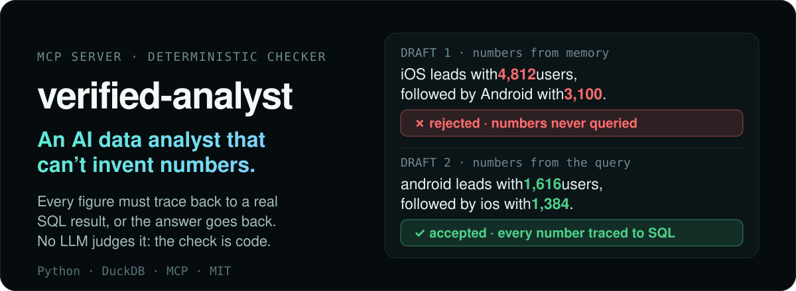
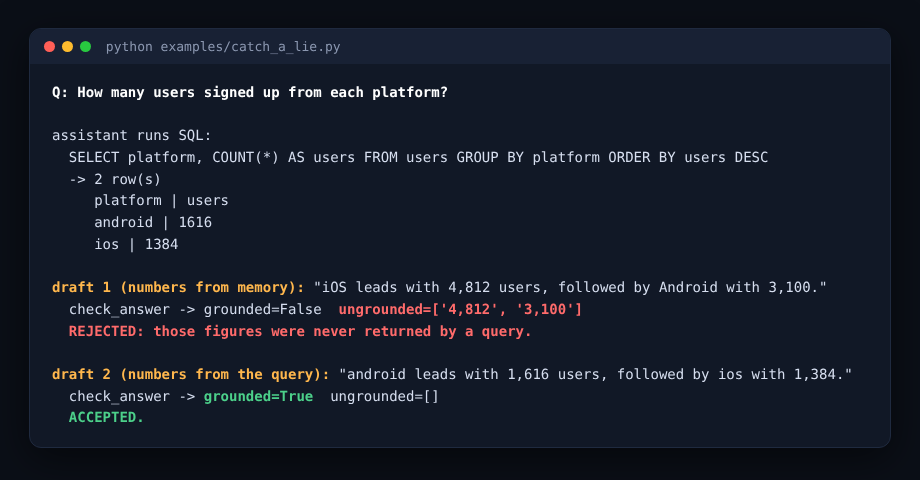
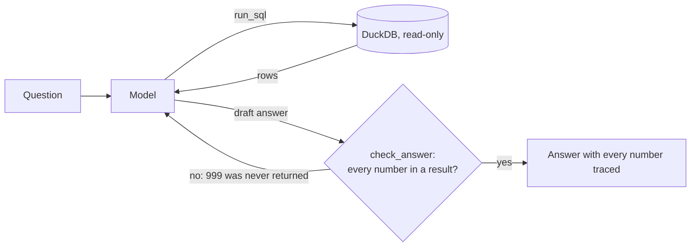
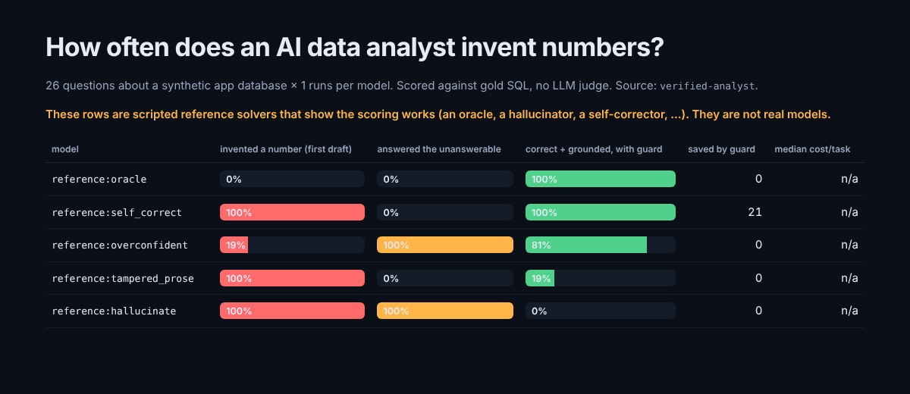

<h1 align="center">
  
</h1>

<p align="center">
  <a href="https://github.com/QasimJaffry/verified-analyst/actions/workflows/ci.yml"></a>
  
  
  
</p>

Ask Claude, Cursor or any AI assistant about a spreadsheet and you usually get a confident answer with figures in it. Some of those figures were never calculated: the model pattern-matched them. `verified-analyst` closes that gap with a **deterministic checker**: every number in an answer must trace back to a value a real SQL query returned, or the answer is sent back for re-analysis.

It ships four ways:

| | what it is | for |
|---|---|---|
| **MCP server** | `describe_schema`, `run_sql`, `check_answer` tools for any MCP client | making Claude Desktop / Claude Code / Cursor check their own numbers |
| **Agent + CLI** | a tool-calling analyst that cannot finish until its prose is grounded | `va ask "..."` on a folder of CSVs |
| **Agent skill** | a `SKILL.md` that makes a coding agent compute in SQL and run `va check` on its draft | Claude Code, Codex and other agents that load skills, with no MCP setup |
| **Leaderboard** | the same oracle-scored eval run across many models | answering *"how often does each model invent numbers?"* |



*Real output of [`examples/catch_a_lie.py`](examples/catch_a_lie.py). The first draft sounds plausible and even names the wrong leader; the checker rejects it because neither figure was ever returned by a query.*



## Use it from Claude or Cursor (MCP)

```bash
pip install "verified-analyst[mcp] @ git+https://github.com/QasimJaffry/verified-analyst"
va data --out ~/va-demo            # optional: a synthetic subscription-app dataset to try it on
```

*(Not on PyPI yet, so the install comes straight from GitHub.)*

Claude Code:

```bash
claude mcp add verified-analyst -- va mcp --data /absolute/path/to/your/csv-folder
```

Claude Desktop / Cursor (`mcpServers` in the client's config file):

```json
{ "mcpServers": { "verified-analyst": { "command": "va", "args": ["mcp", "--data", "/absolute/path/to/your/csv-folder"] } } }
```

Every `.csv` in the folder becomes a table. The server tells the assistant to compute figures in SQL and to call `check_answer` on its draft; `check_answer` returns which numbers were never returned by a query in the session:

```json
{ "grounded": false, "ungrounded": ["999"], "numbers_checked": ["1234", "999"],
  "note": "These numbers were not returned by any query in this session. Compute them with run_sql ..." }
```

The data folder is fixed when the server starts, queries are SELECT-only with file access disabled, and the checker calls no model.

## Use it as an agent skill, or from a script

```bash
npx skills add QasimJaffry/verified-analyst      # installs skills/verified-numbers
```

In Claude Code you can also install it as a plugin:

```text
/plugin marketplace add QasimJaffry/verified-analyst
/plugin install verified-analyst@verified-analyst
```

The skill needs the `va` command on the machine. If it is missing, the skill asks before running `pip install "verified-analyst @ git+https://github.com/QasimJaffry/verified-analyst"`.

The skill tells the agent to compute each figure in SQL and to run one stateless command on its draft before answering:

```bash
va check --data ./data \
  --sql "SELECT platform, COUNT(*) AS users FROM users GROUP BY platform" \
  --answer "iOS leads with 4,812 users."
# prints JSON with "ungrounded": ["4,812"] and exits 1
```

Exit code 0 means every number came from one of the given queries, 1 means some did not, 2 means a query was rejected. That makes it usable in CI or any script, with no model involved.

## The leaderboard: how often does each model invent numbers?

```bash
export OPENROUTER_API_KEY=...       # one key, many models
va data
va leaderboard --models <model-id>,<model-id>,<model-id> --runs 3
# model ids: any tool-calling model from openrouter.ai/models (ids change often, so copy current ones)
# -> results/leaderboard/LEADERBOARD.md, leaderboard.json, index.html (+ per-model runs.csv)
```

For each model it reports:

- **invented a number**: share of runs whose *first* answer stated a figure none of its own queries returned (raw model behaviour, before the guard steps in)
- **answered the unanswerable**: on questions the data cannot answer, how often it produced a number anyway
- **correct + grounded**: final answers that match the oracle *and* pass the checker, with the guard on
- **saved by guard**: runs that invented a number, got bounced back, then passed
- median **cost** per question (from OpenRouter's price list) and latency

> **No real-model results are published yet.** The first run will be committed under `results/` with its date, versions and data hashes. Nothing on this page is a model's score.

Until then, here is the pipeline run against deterministic reference solvers (scripted, **not real models**). This proves the metrics measure what they claim (`va leaderboard --models reference:oracle,reference:self_correct,reference:overconfident,reference:tampered_prose,reference:hallucinate --runs 1`):



| solver | invented a number | answered the unanswerable | correct + grounded | saved by guard |
|---|---:|---:|---:|---:|
| `oracle` (always faithful) | 0% | 0% | 100% | 0 |
| `self_correct` (fudges, then fixes when rejected) | 100% | 0% | 100% | 21 |
| `overconfident` (answers impossible questions) | 19% | 100% | 81% | 0 |
| `tampered_prose` (nudges numbers) | 100% | 0% | 19% | 0 |
| `hallucinate` (never queries) | 100% | 100% | 0% | 0 |

## Use it standalone

```bash
pip install "verified-analyst @ git+https://github.com/QasimJaffry/verified-analyst"   # add [anthropic] for the Anthropic provider
va data                                 # synthetic dataset in ./data
va ask "Which channel converts best after the trial?" --show-sql --chart-out chart.json
va eval --provider openrouter --model <model-id> --runs 5 --out results/my-model
```

`chart.json` is a Vega-Lite spec built only from rows the last query returned: the model picks the chart type and columns, never the data points.

## What is different from the many "chat with your CSV" tools

1. **A numeric-claim verifier on the final prose** ([`verify.py`](src/verified_analyst/verify.py)). Not an LLM judge: rounding-, percent- and suffix-aware matching of each number against returned cells. Arithmetic in prose is rejected on purpose, so the figure must be `SELECT`ed.
2. **Oracle scoring, no LLM judge** ([`scoring.py`](src/verified_analyst/evals/scoring.py)). Expected answers come from executing each task's gold SQL. A run passes only if the value is correct **and** the prose is grounded.
3. **Questions it should refuse.** 5 of 26 tasks have no valid numeric answer (missing data, or too vague). Inventing a number there is a failure.
4. **The harness is tested against its own mutants.** Deliberately wrong solvers must fail; a faithful one must pass 100%. CI enforces it.

Related open-source work: several DuckDB/SQL MCP servers give assistants query access, [`andon-verify`](https://github.com/gulmezeren2-byte/andon) re-checks numbers in finished reports, and text-to-SQL agents abound. This project's narrower claim is the in-loop, prose-level number check plus a refusal-aware oracle eval and a cross-model leaderboard.

## Harness validation (no model involved)

`python scripts/harness_table.py`

| reference solver | answerable passed (of 21) | refusal/clarify passed (of 5) | what it proves |
|---|---|---|---|
| `oracle` | 21 | 5 | a faithful solver passes everything |
| `wrong_value` | 0 | 5 | right prose, wrong `value`: the **scorer** catches it |
| `tampered_prose` | 0 | 5 | `value` right, prose number nudged: the **verifier** catches it |
| `hallucinate` | 0 | 0 | never queries, invents a number: verifier catches it; also fails refusals |
| `overconfident` | 21 | 0 | answers vague/impossible questions with a number: scorer catches it |
| `refuse_all` | 0 | 3 | blanket refusal cannot game the eval (the 2 vague tasks need `needs_clarification`) |
| `self_correct` | 21 | 5 | a model the guard rescues still gets credit, and is counted as "saved by guard" |

## How the verifier decides

| answer says | query returned | verdict |
|---|---|---|
| `1,616 Android users` | `1616` | grounded |
| `Average is 4.5` | `4.4567` | grounded (rounded to the digits shown) |
| `40.8%` | `0.408` or `40.8` | grounded |
| `about 41.6k` | `41581.04` | grounded |
| `Average is 4.47` | `4.4567` | **rejected** (wrong at the second decimal) |
| `3000 users in total` | rows `1616`, `1384` | **rejected**: 3000 was never returned, so `SELECT` the sum |
| `signed up on 2025-03-14` | n/a | dates and clock times are not claims |

Limit worth stating plainly: the verifier proves the numbers **came from a query**, not that the query **answered the question**. A real cell quoted for the wrong metric passes the verifier and is caught only by the oracle eval. See [DESIGN.md](DESIGN.md).

## SQL safety (does not rely on the model behaving)

- exactly one statement, and DuckDB's own parser must classify it as `SELECT`
- external access is switched off after the data loads and the configuration is locked, so `read_csv('/etc/passwd')`, `COPY`, `ATTACH`, `SET ...` all fail
- 100-row result cap and a 10 s timeout that cancels runaway queries
- no code-execution tool (see DESIGN.md for why)

## Eval design

- **Dataset:** synthetic subscription mobile app (users, subscriptions, payments), seeded and reproducible. It is synthetic; nothing describes a real app.
- **Tasks:** 26 in [`evals/tasks.jsonl`](evals/tasks.jsonl): lookup 5, aggregate 6, join 6, time 4, unanswerable 3, ambiguous 2.
- **Reporting:** pass rate with a Wilson 95% interval, latency as p50/p95 (never the mean), median steps and tokens, unverified-number rate, per-category breakdown, `runs.csv` with every run. Metadata (date, versions, dataset and task hashes) is written next to the numbers.
- **Scale caveat:** 26 tasks is a small, single-schema set, so treat the leaderboard as a pilot. Wilson intervals are reported precisely because they are wide.

## Layout

```
src/verified_analyst/
  agent.py        loop, tools, verification gate (records the first draft before the guard)
  verify.py       numeric-claim extraction + grounding
  mcp_server.py   MCP tools for Claude / Cursor (core is transport-independent)
  db.py           DuckDB session, SELECT-only guard, schema description
  charts.py       Vega-Lite spec from returned rows
  providers/      anthropic, openai-compatible (stdlib HTTP)
  datagen.py      seeded synthetic dataset
  evals/          tasks, oracle scoring, stats, runner, reference solvers, leaderboard
evals/tasks.jsonl
tests/            129 tests, incl. a real MCP stdio round trip
skills/           verified-numbers agent skill (uses `va check`)
```

## Limitations

- Verified-by-query is not verified-correct: a real cell quoted for the wrong metric passes the checker and is caught only by the oracle eval.
- Small integers can be grounded by coincidence because rounding tolerance is real.
- In MCP mode the checker only helps if the assistant calls it; the server's instructions ask it to, but clients decide.
- One schema and 26 tasks: the leaderboard is a pilot. More schemas and tasks are the next step.
- Provider code is tested at the wire-format level, not against live APIs in CI.

MIT licensed.
