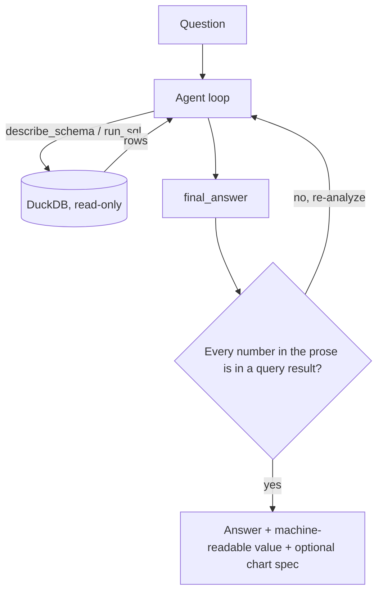

# verified-analyst

A tool-calling **SQL analyst agent that is not allowed to state a number its own queries did not return**, plus an **oracle-scored eval harness** that measures how often a model gets there.

Ask a question in plain English about a CSV/database; the agent plans, runs read-only SQL (DuckDB), and answers. Before the answer is accepted, a deterministic checker confirms that **every figure in the prose appears in a query result**. If one does not, the answer is bounced back for re-analysis.



## Status (read this first)

| | |
|---|---|
| Agent, verifier, SQL guard, charts | implemented and tested (98 tests) |
| Eval harness (oracle scoring, Wilson CIs, 26 tasks) | implemented and validated against mutant solvers (below) |
| OpenAI-compatible + Anthropic providers | implemented; wire format tested against a local mock server / fake client |
| **Results for a real model** | **not published yet.** No numbers here are from a model; run the command below and commit the output under `results/` |

```bash
pip install -e ".[anthropic]"
va data                                   # synthetic subscription-app dataset
export ANTHROPIC_API_KEY=...              # or: VA_API_KEY / VA_BASE_URL / VA_MODEL for any OpenAI-compatible endpoint
va eval --provider anthropic --runs 5 --out results/$(date +%F)-anthropic
```

## What is different from the many "chat with your CSV" agents

1. **A numeric-claim verifier on the final prose** ([`verify.py`](src/verified_analyst/verify.py)). Not an LLM judge: rounding-, percent- and suffix-aware matching of each number against returned cells. Arithmetic in prose is rejected on purpose, so the agent must `SELECT` the figure it reports.
2. **Oracle scoring, no LLM judge** ([`scoring.py`](src/verified_analyst/evals/scoring.py)). Expected answers are the result of executing each task's gold SQL. A run passes only if the value is *correct* **and** the prose is *grounded*.
3. **Tasks the agent should refuse.** 5 of 26 tasks have no valid numeric answer (missing data, or a question too vague to answer). Inventing a number there is a failure.
4. **The harness is tested against its own mutants.** Reference solvers that are deliberately wrong must fail; a faithful one must pass 100%.

Related open-source work, for context: `agentic_TRACE` (deterministic tool-routed analysis), `agentic-duckdb-analyst` (self-validating eval harness), and several text-to-SQL agents. This project's narrower claim is the *prose-level* number check plus the refusal-aware oracle eval.

## Harness validation (no model involved)

Reproduce with `python scripts/harness_table.py`.

| reference solver | answerable passed (of 21) | refusal/clarify passed (of 5) | what it proves |
|---|---|---|---|
| `oracle` | 21 | 5 | a faithful solver passes everything |
| `wrong_value` | 0 | 5 | right prose, wrong `value`: the **scorer** catches it |
| `tampered_prose` | 0 | 5 | `value` right, prose number nudged: the **verifier** catches it |
| `hallucinate` | 0 | 0 | never queries, invents a number: verifier catches it; also fails refusals |
| `overconfident` | 21 | 0 | answers vague/impossible questions with a number: scorer catches it |
| `refuse_all` | 0 | 3 | blanket refusal cannot game the eval (the 2 vague tasks need `needs_clarification`) |

## How the verifier decides

| answer says | query returned | verdict |
|---|---|---|
| `1,616 Android users` | `1616` | grounded |
| `Average is 4.5` | `4.4567` | grounded (rounded to the digits shown) |
| `40.8%` | `0.408` or `40.8` | grounded |
| `about 41.6k` | `41581.04` | grounded |
| `Average is 4.47` | `4.4567` | **rejected** (wrong at the second decimal) |
| `3000 users in total` | rows `1616`, `1384` | **rejected**: 3000 was never returned, so `SELECT` the sum |
| `signed up on 2025-03-14` | n/a | dates and clock times are not claims |

Limit worth stating plainly: the verifier proves the numbers **came from a query**, not that the query **answered the question**. A real cell quoted for the wrong metric passes the verifier and is caught only by the oracle eval. See [DESIGN.md](DESIGN.md).

## SQL safety (does not rely on the model behaving)

- exactly one statement, and DuckDB's own parser must classify it as `SELECT`
- external access is switched off after the data loads and the configuration is locked, so `read_csv('/etc/passwd')`, `COPY`, `ATTACH`, `SET ...` all fail
- 100-row result cap and a 10 s timeout that cancels runaway queries
- no code-execution tool (see DESIGN.md for why)

## Eval design

- **Dataset:** synthetic subscription mobile app (users, subscriptions, payments), seeded and reproducible. It is synthetic; nothing describes a real app.
- **Tasks:** 26 in [`evals/tasks.jsonl`](evals/tasks.jsonl): lookup 5, aggregate 6, join 6, time 4, unanswerable 3, ambiguous 2.
- **Reporting:** pass rate with a Wilson 95% interval, latency as p50/p95 (never the mean), median steps and tokens, unverified-number rate, per-category breakdown, `runs.csv` with every run. Metadata (date, versions, dataset and task hashes) is written next to the numbers.
- **Scale caveat:** 26 tasks is a small, single-schema set. Wilson intervals are reported precisely because they are wide. Treat results as a pilot, not a leaderboard.

## Use

```bash
va ask "Which channel converts best after the trial?" --show-sql --chart-out chart.json
va schema                                  # what the agent sees
va eval --provider reference:oracle --min-pass 1.0
```

`chart.json` is a Vega-Lite spec built only from rows the last query returned; the model picks the chart type and columns, never the data points.

## Layout

```
src/verified_analyst/
  agent.py        loop, tools, verification gate
  verify.py       numeric-claim extraction + grounding
  db.py           DuckDB session, SELECT-only guard, schema description
  charts.py       Vega-Lite spec from returned rows
  providers/      anthropic, openai-compatible (stdlib HTTP)
  datagen.py      seeded synthetic dataset
  evals/          tasks, oracle scoring, stats, runner, reference solvers
evals/tasks.jsonl
tests/            98 tests
```

## Limitations

- Verified-by-query is not verified-correct (above).
- Small integers can be grounded by coincidence because rounding tolerance is real; the oracle eval is the backstop.
- One schema, one dialect (DuckDB), no cross-turn memory, no write operations.
- Provider code is tested at the wire-format level, not against live APIs in CI.

MIT licensed.
